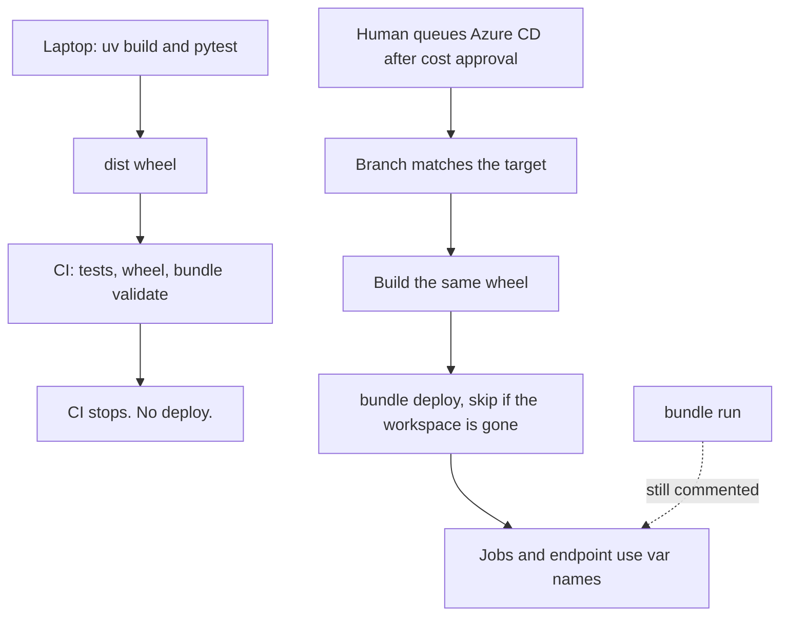
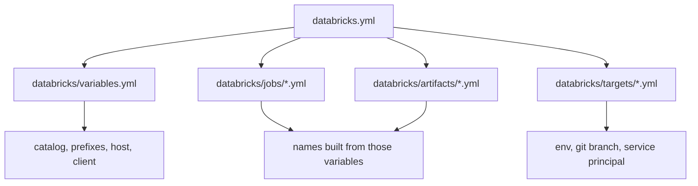
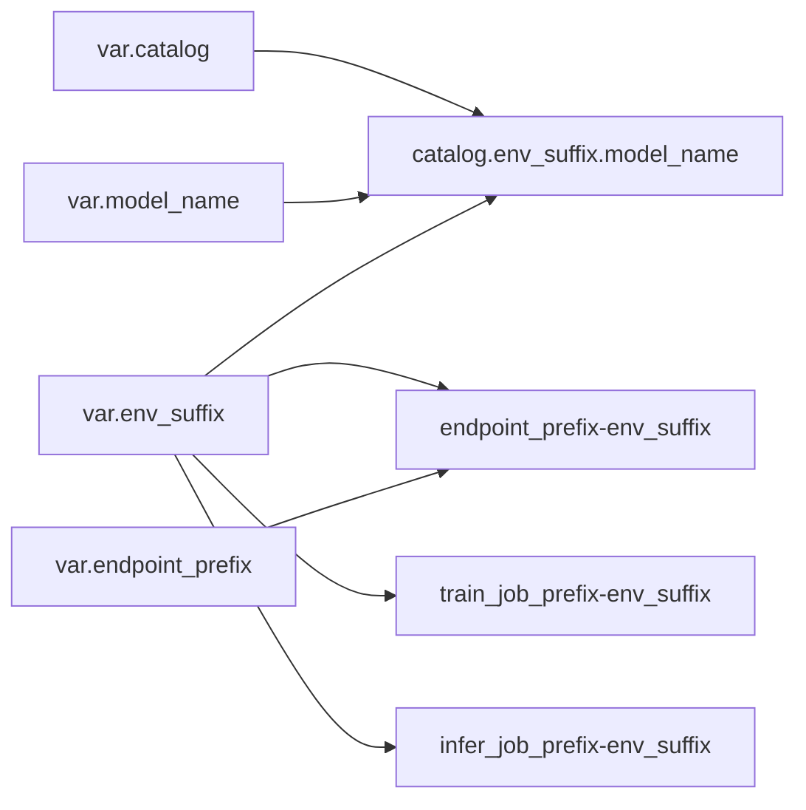
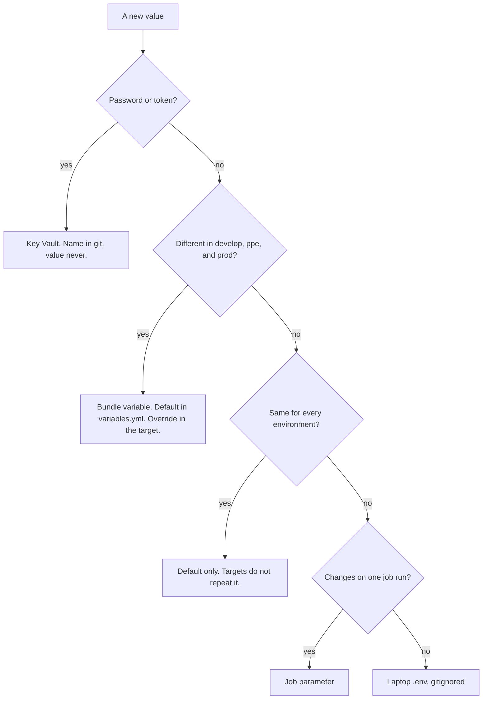
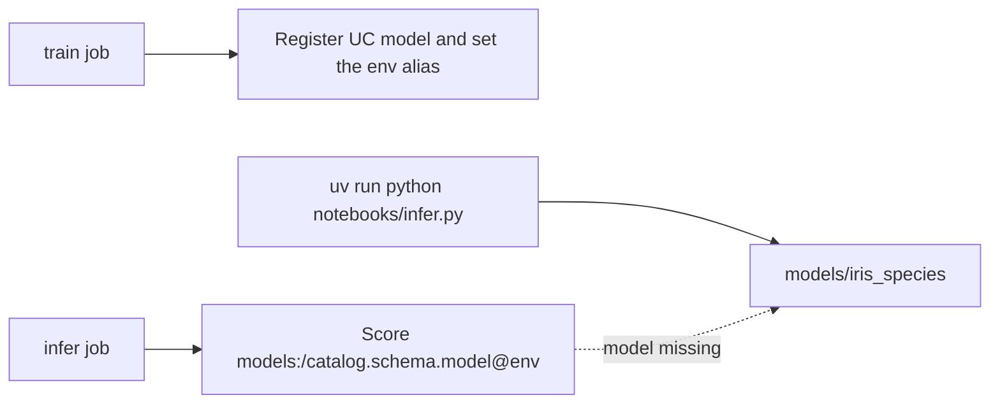
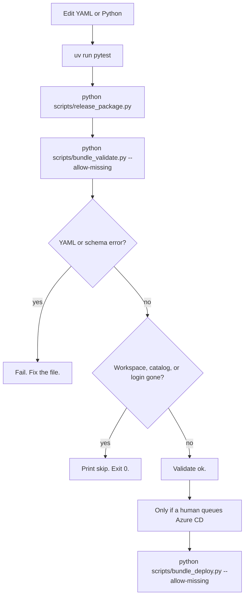
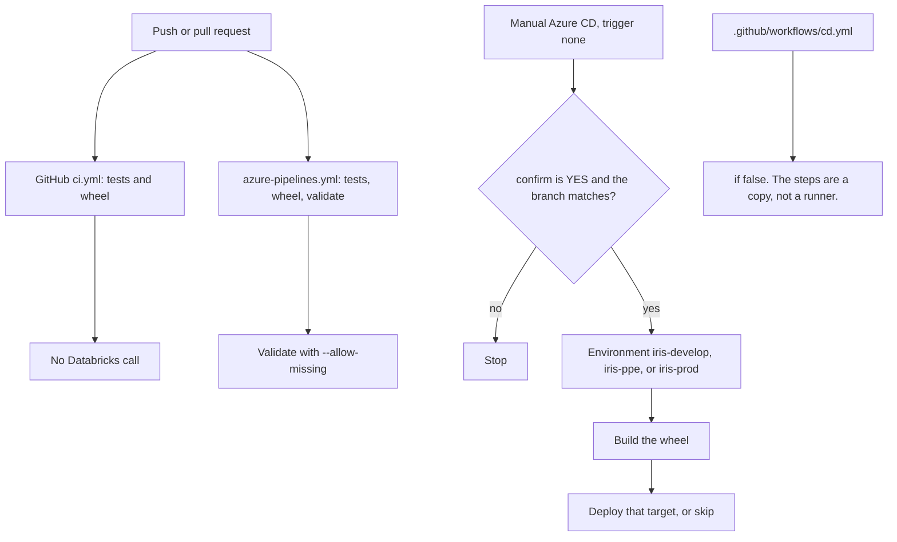

# Bundle best practices, ELI25

This page is why the iris bundle is shaped the way it is. The short version:
names are parameters, secrets are not, validate is free, the wheel is the
release package, and deploy is a gated step that skips a missing workspace.

The file map is [databricks-bundle-best-practices.md](databricks-bundle-best-practices.md).
Where a value is allowed to live is [where-to-put-variables.md](where-to-put-variables.md).

## One picture

`databricks bundle run` stays a comment. A deleted workspace must not be
recreated by a train or infer job, and it must not be recreated because
login failed.

## Why the root file is thin

`databricks.yml` has three jobs: the bundle name, the wheel build, and the
include list. Jobs, the endpoint, targets, and variable defaults are files
under `databricks/`.

A thin root is easier to review. A change to the train job does not hide
inside a 400-line file that also holds prod.

The wheel line is `uv build --wheel` with `dynamic_version: true`. Deploy
uploads that wheel. Tasks import `iris_model`. They do not pip-install the
library and they do not put `src` on `sys.path`.

## Why names are variables

A name that appears in the train job, the infer job, and the endpoint is
one fact. If it is typed three times, the third copy will drift.

| Variable | Default | Why it is a parameter |
|---|---|---|
| `catalog` | `dbw_iris_ml_dev` | Same catalog for every env. The schema is the env suffix. |
| `model_name` | `iris_species` | The object inside that schema. |
| `endpoint_prefix` | `iris-species` | Endpoint and MLflow experiment share this stem. |
| `train_job_prefix` | `iris-ml-train` | Train stays a separate job from infer. |
| `infer_job_prefix` | `iris-ml-infer` | Infer can run without a new train. |
| `project` | `iris-ml` | A tag. Not a login. |
| `workspace_host` | the shared workspace URL | One host today. A target overrides it when that env gets its own workspace. |
| `serverless_client` | `4` | Client 4 is Python 3.12. Client 2 is 3.11 and cannot install the wheel. |
| `env_suffix` | `develop` | Appended to every name. `ppe` and `prod` override it. |
| `git_branch` | `develop` | The only git branch allowed to deploy that target. Prod's branch is `main`. |
| `model_version` | `5` | The version the endpoint YAML names. CD can still point the alias later. |
| `owner` | `iris-learn` | A tag. Not auth. |
| `service_principal_application_id` | the develop app id | Who the job runs as. Each target sets its own app id. Not a secret. |

Python uses the same strings in `src/iris_model/promotion.py`. A test fails
if `databricks/variables.yml` and that module disagree.

What stays a literal on purpose:

- `workload_size: Small` and `scale_to_zero_enabled: true`. Those are the
  cost decision, not an environment difference. A variable would make it
  easy to turn the endpoint into a larger bill.
- Job timeouts and `max_concurrent_runs: 1`. Those are per job, not per env.
- Passwords, tokens, and client secrets. Those are Key Vault. A bundle
  variable would put them in git.

## Where a value is allowed to live

Targets override only what changes: `env`, `git_branch`, `env_suffix`, and
the service principal application id. The host is `${var.workspace_host}`
in all three target files. When ppe or prod gets its own workspace, that
target sets `workspace_host`. It does not copy a URL into the job files.

## Two jobs, not one pipeline

Train and infer are separate jobs so a serve path can score the model that
already exists. A chained pipeline would start training to answer a score.

Local infer tries the `models:/` URI first. If that registered model is
gone, it scores the committed folder `models/iris_species` and says so.
Laptop tests do not need a live catalog.

## Validate, package, deploy

| Step | Command | Spends? | Missing workspace |
|---|---|---|---|
| Tests | `uv run pytest -q` | No | Still pass. Live validate skips. |
| Package | `python scripts/release_package.py` | No | Still builds `dist/iris_model-<version>-*.whl` from `pyproject.toml`. |
| Validate | `python scripts/bundle_validate.py --allow-missing -t develop -t ppe -t prod` | No | Skip that target. A bad field still fails. |
| Deploy | `python scripts/bundle_deploy.py --allow-missing -t <target>` | Yes, when login works | Skip. Do not create the workspace. |
| Job run | commented `databricks bundle run` | Would spend | Does not run. |

`--allow-missing` is the fallback. It matches a deleted catalog, a missing
model or endpoint, an unreachable host, or a rejected login (`403`). It
does not hide `unknown field` or other schema errors.

Azure CI builds the wheel and publishes it as `iris-model-wheel`. GitHub
test CI builds the same wheel. Neither workflow contains `databricks bundle
deploy` or `databricks bundle run`.

## Why CD is a different file

Git branch `develop` deploys target `develop`. `ppe` deploys `ppe`. `main`
deploys `prod`. There is no git branch named `prod`.
`scripts/assert_deploy_branch.py` refuses the wrong pair before deploy.

Do not queue `azure-pipelines-cd.yml` until
[cost-tracker.md](../cost-tracker.md) is approved. Deploy updates jobs and
the endpoint inside a workspace that already exists. It does not create the
resource group, the workspace, or the catalog.

## What you change when something moves

| You need | Change this | Leave this |
|---|---|---|
| A new catalog name | `catalog` in `databricks/variables.yml` and `CATALOG` in `src/iris_model/promotion.py` | Job YAML. It already uses `${var.catalog}`. |
| ppe on its own workspace | `workspace_host` under `targets.ppe.variables` | develop and prod |
| A new service principal | `service_principal_application_id` on that target | The client secret. That stays in Key Vault. |
| Python 3.12 on serverless | `serverless_client` only if Databricks renames client 4 | Do not set client `2` |
| A bigger endpoint | Do not. That is a cost-sheet change, then the literal in `iris_endpoint.yml`. | |

## What you do not do

- Do not put a token, password, or client secret in `variables.yml`.
- Do not copy `dbw_iris_ml_dev` back into a job file. Use `${var.catalog}`.
- Do not add `databricks bundle deploy` or `databricks bundle run` to
  `azure-pipelines.yml` or `.github/workflows/ci.yml`.
- Do not remove `if: ${{ false }}` from `.github/workflows/cd.yml`.
- Do not uncomment `databricks bundle run` until cost approval, and not
  while the workspace is deleted.
- Do not treat a skipped validate as proof the YAML is deployed.
