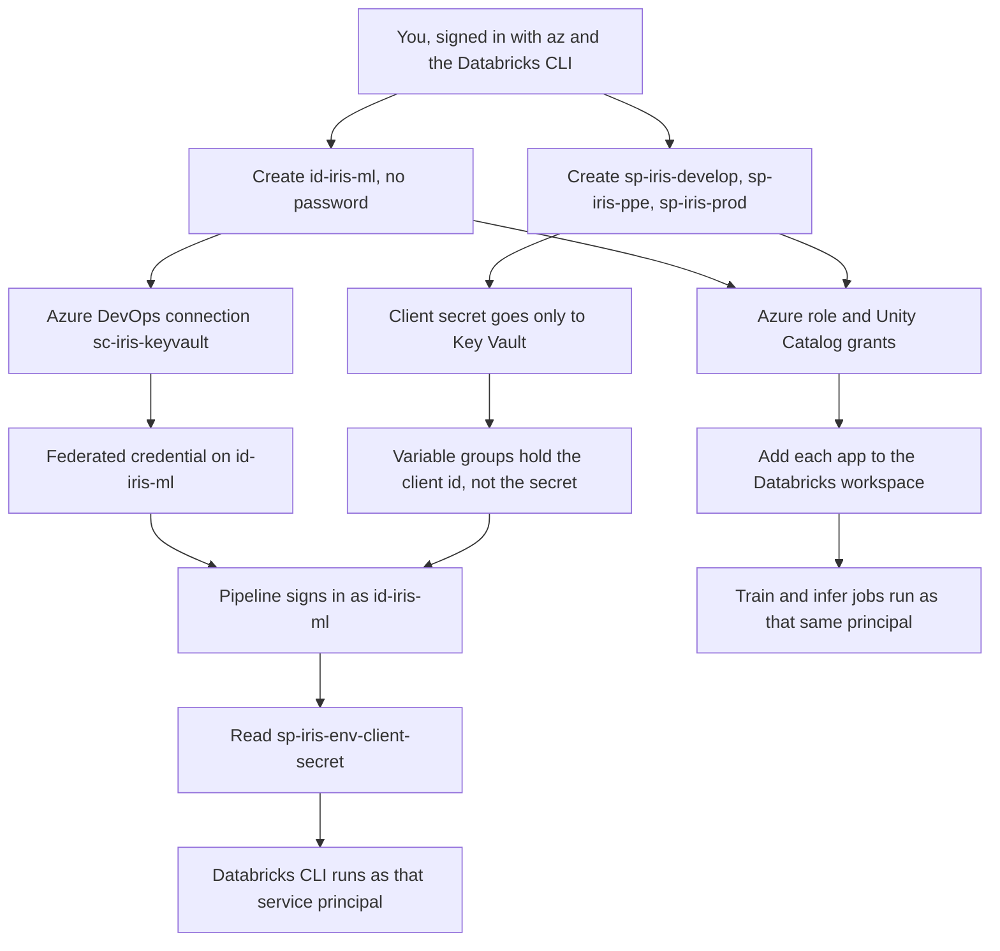
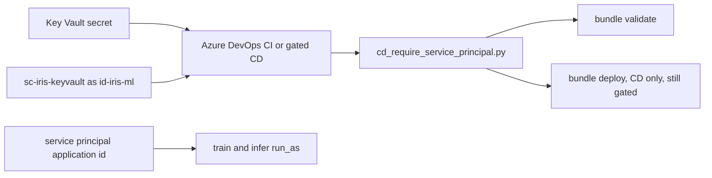
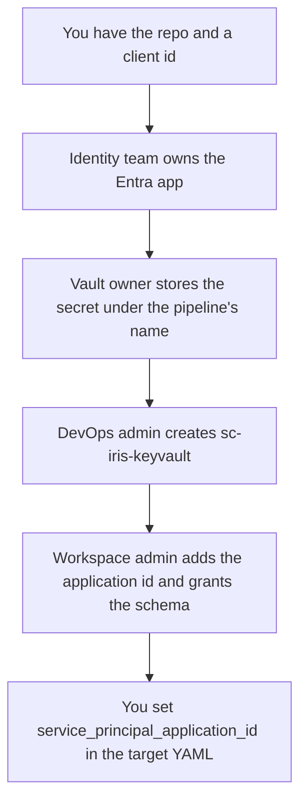

# Identities from creation to use, ELI25

This is the long version of [eli25-identities.md](eli25-identities.md).
That page is the map. This page is the trip: how the accounts were
created, which screen or command does each step, where the pipeline
uses them, and what to do in a company where you cannot create an
application yourself.

The client ids are in [`infra/identities.json`](../../infra/identities.json).
The passwords are not in git. Do not paste a client secret into this
page, a pull request, or a chat.

Paid deploy stays gated. Nothing on this page is permission to run
`azure-pipelines-cd.yml`. The cost tracker is still the gate.

## The trip in one picture



A service principal is an Entra application. It has a client id, which
is public, and a client secret, which is a password. A managed identity
is an Azure resource account. `id-iris-ml` has a client id and no
password. Azure DevOps proves who it is with a federated credential
instead of a secret.

## The four accounts

| Who | Created by | Password | What it is allowed to do |
|---|---|---|---|
| You | Your Entra user | Your login | Laptop `bundle validate`, the workspace UI |
| `id-iris-ml` | This repo, in `rg-iris-ml-dev` | None | Read Key Vault. Contributor on workspace `dbw-iris-ml-dev`. Read the three schemas. It does not train |
| `dbmanagedidentity` | Databricks, in the managed resource group | None | Key Vault `get` and `list` only |
| `sp-iris-develop`, `sp-iris-ppe`, `sp-iris-prod` | This repo, one app each | Secret in Key Vault | Reader on the workspace. Write on its own schema. `run_as` for that environment's jobs |

`dbmanagedidentity` already exists when the workspace exists. The grant
script does not create it. If the workspace has been deleted, that
identity is gone with the managed resource group, and the script stops
when it looks the identity up.

## Where each name is written

| Fact | Where it lives |
|---|---|
| Display names, client ids, secret names, roles | `infra/identities.json` |
| The same names in Python | `src/iris_model/identities.py` |
| Which app id a job runs as | `databricks/targets/develop.yml`, `ppe.yml`, `prod.yml` |
| Job `run_as` | `databricks/jobs/iris_ml_train.yml` and `iris_ml_infer.yml` |
| Host, tenant, client id | Variable groups `iris-develop`, `iris-ppe`, `iris-prod` |
| Client secret | Key Vault `kv-iris-ml-dev-7405`, secret `sp-iris-<target>-client-secret` |
| How the agent becomes `id-iris-ml` | Azure DevOps service connection `sc-iris-keyvault` |

The secret names are `sp-iris-develop-client-secret`,
`sp-iris-ppe-client-secret`, and `sp-iris-prod-client-secret`. The
pipeline asks Key Vault for that exact name.

## What has to exist before the grant script

The script is [`scripts/grant_identity_access.py`](../../scripts/grant_identity_access.py).
It is safe to run again. An app that already has the display name is
reused. A Key Vault secret that already exists is left alone, so a
second run does not rotate the password. A role that is already
assigned is left alone.

It does not create the service connection. Create `sc-iris-keyvault`
first, or the script creates the apps and then stops at the federation
step. The clicks are in [Azure DevOps](#azure-devops-screens).

Sign in as a user who can create the identity, the apps, the role
assignments, and the Key Vault access policy. A later section is for
when you cannot.

```bash
az login
az account set --subscription 1d8cc420-e891-4710-b1fa-03206d4fde2a
az devops configure --defaults \
  organization=https://dev.azure.com/akumawavez \
  project=iris-ml-prod-test
databricks auth login --host https://adb-7405619226406985.5.azuredatabricks.net
```

The Databricks login here is you. The service principals are created
by the next command. They are not this login.

## One command that creates and grants

From the repo root, after the sign-in above and after
`sc-iris-keyvault` exists:

```bash
uv run python scripts/grant_identity_access.py
```

The script then does this, in order:

1. Create user-assigned managed identity `id-iris-ml` in `rg-iris-ml-dev`.
2. Give `id-iris-ml` and `dbmanagedidentity` Key Vault secret `get` and `list` on `kv-iris-ml-dev-7405`.
3. Give `id-iris-ml` Contributor on workspace `dbw-iris-ml-dev`.
4. Add `id-iris-ml` to the Databricks workspace and turn on workspace access.
5. For `develop`, `ppe`, and `prod`: create the Entra app if the display name is missing, create its service principal, store a one-year secret named `iris-cd` only when the Key Vault secret is missing, and give the principal Reader on the workspace.
6. Add each service principal to the workspace and turn on workspace access.
7. Grant Unity Catalog. Each service principal gets `USE CATALOG` and, on its own schema, `USE SCHEMA`, `CREATE MODEL`, `CREATE TABLE`, `MODIFY`, `SELECT`, and `EXECUTE`. `id-iris-ml` gets `USE SCHEMA`, `SELECT`, and `EXECUTE` on all three schemas.
8. If the registered model already exists, grant that environment's service principal `ALL PRIVILEGES` and `MANAGE` on the function. A missing model is skipped.
9. Create or update variable groups `iris-develop`, `iris-ppe`, and `iris-prod` with the host, tenant, client id, and workspace resource id. Delete `ARM_CLIENT_SECRET` from the group if someone put it there.
10. Read the issuer and subject from `sc-iris-keyvault` and store them as federated credential `ado-sc-iris-keyvault` on `id-iris-ml`. Also store GitHub federated credentials `github-develop`, `github-ppe`, and `github-main`.
11. Rewrite `infra/identities.json` with the client ids. Commit that file. It has no secret.

The GitHub credential subject is
`repo:akumawavez/iris-ml-prod-test:ref:refs/heads/<branch>`.
The prod Databricks target uses git branch `main`, so the credential
is `github-main`. [`.github/workflows/cd.yml`](../../.github/workflows/cd.yml)
stays disabled. Those GitHub credentials do not turn that workflow on.

## The same work as separate commands

Use these when you need one step, or when you are checking what the
script did. Replace `<app-id>` and `<principal-object-id>` from
`az ad sp show`. Do not pass a password on the command line. The script
writes the secret to a mode `600` temp file, stores it, and deletes
the file.

```bash
az identity create -g rg-iris-ml-dev -n id-iris-ml \
  --query "{clientId:clientId,principalId:principalId}" -o json

az keyvault set-policy --name kv-iris-ml-dev-7405 \
  --object-id <principal-object-id> \
  --secret-permissions get list

az role assignment create \
  --assignee-object-id <principal-object-id> \
  --assignee-principal-type ServicePrincipal \
  --role Contributor \
  --scope /subscriptions/1d8cc420-e891-4710-b1fa-03206d4fde2a/resourceGroups/rg-iris-ml-dev/providers/Microsoft.Databricks/workspaces/dbw-iris-ml-dev

az ad app create --display-name sp-iris-develop --query appId -o tsv
az ad sp create --id <app-id>
```

Reader for a service principal uses the same `az role assignment create`
with `--role Reader` and that app's object id. The managed identity
keeps Contributor. The service principals stay Reader.

A new secret, only when Key Vault does not already have
`sp-iris-develop-client-secret`:

```bash
az ad app credential reset --id <app-id> --display-name iris-cd --years 1
az keyvault secret set --vault-name kv-iris-ml-dev-7405 \
  --name sp-iris-develop-client-secret --file <mode-600-file>
```

Put the password in the file, run the set, then delete the file.
Running `credential reset` when a secret already works will add another
password in Entra. The script skips that command when the Key Vault
name is already present.

Add the app to the workspace and allow it to call the workspace API:

```bash
databricks service-principals create \
  --application-id <app-id> \
  --display-name sp-iris-develop \
  --active
```

Workspace access is an entitlement. The script sets
`entitlements` to `workspace-access` with
`databricks service-principals update`.

Catalog grants, using the application id as the principal:

```sql
GRANT USE CATALOG ON CATALOG dbw_iris_ml_dev TO `<app-id>`;
GRANT USE SCHEMA, CREATE MODEL, CREATE TABLE, MODIFY, SELECT, EXECUTE
  ON SCHEMA dbw_iris_ml_dev.develop TO `<sp-iris-develop-app-id>`;
GRANT USE SCHEMA, SELECT, EXECUTE
  ON SCHEMA dbw_iris_ml_dev.develop TO `<id-iris-ml-client-id>`;
```

Repeat the schema grants for `dbw_iris_ml_dev.ppe` and
`dbw_iris_ml_dev.prod`. `sp-iris-ppe` writes only `ppe`.
`sp-iris-prod` writes only `prod`. `id-iris-ml` gets the read
privileges on each schema and does not get `CREATE MODEL`.

## Azure portal screens

### Managed identity

You need Managed Identity Contributor, or Contributor, on
`rg-iris-ml-dev`.

1. Open [https://portal.azure.com](https://portal.azure.com).
2. Search for **Managed Identities**.
3. Select **Create**.
4. Subscription: the iris subscription. Resource group: `rg-iris-ml-dev`. Name: `id-iris-ml`. Region: the same region as the workspace.
5. Select **Review + create**, then **Create**.
6. Open the identity. Copy **Client ID**. Leave **Object (principal) ID** for the role assignment. There is no password blade.

`dbmanagedidentity` is under the Databricks-managed resource group
`databricks-rg-dbw-iris-ml-dev-bpjytdnacwiyl`. Open it to confirm it
exists. Do not delete that group while the workspace exists.

### Entra application and secret

You need permission to register applications. In many tenants that
permission is off. Use the enterprise section below when **New
registration** is missing.

1. Open [https://entra.microsoft.com](https://entra.microsoft.com).
2. **Identity** → **Applications** → **App registrations** → **New registration**.
3. Name: `sp-iris-develop`. Supported account types: this tenant only. Register.
4. Copy **Application (client) ID**. That value is `ARM_CLIENT_ID`.
5. **Certificates & secrets** → **Client secrets** → **New client secret**.
6. Description: `iris-cd`. Expires: 12 months. Add.
7. Copy the **Value** once. The portal will not show it again.
8. Open Key Vault `kv-iris-ml-dev-7405` → **Secrets** → **Generate/Import**. Name: `sp-iris-develop-client-secret`. Value: the secret you just copied. Create.
9. Clear the secret from your clipboard. Do not put it in the variable group.

Repeat for `sp-iris-ppe` and `sp-iris-prod`.

Creating the registration creates the application object. If
**Enterprise applications** does not already list it, create the
service principal from the app. The CLI equivalent is `az ad sp create`.

### Roles and Key Vault

On workspace `dbw-iris-ml-dev`:

1. **Access control (IAM)** → **Add role assignment**.
2. Role **Contributor**. Members: managed identity `id-iris-ml`. Review and assign.
3. Add another assignment. Role **Reader**. Members: `sp-iris-develop`. Repeat for `ppe` and `prod`.

This vault uses an access policy, which is what
`az keyvault set-policy` writes.

1. Open `kv-iris-ml-dev-7405` → **Access policies** → **Create**.
2. Secret permissions: **Get** and **List** only.
3. Principal: `id-iris-ml`. Create.
4. Repeat for `dbmanagedidentity`.

The service principals do not get a Key Vault policy. They never read
the vault. The pipeline reads the vault as `id-iris-ml`, then passes
the value into the Databricks step.

### Federated credential

1. Open managed identity `id-iris-ml` → **Settings** → **Federated credentials** → **Add credential**.
2. Scenario: **Other issuer**.
3. Issuer and subject: the two values Azure DevOps shows on `sc-iris-keyvault`.
4. Audience: `api://AzureADTokenExchange`.
5. Name: `ado-sc-iris-keyvault`. Add.

The grant script writes this credential for you when the service
connection already exists. Add it by hand when the portal will not
save the connection until the credential exists. Use the same name so
the script sees it and skips.

## Databricks screens

You need a workspace admin for these clicks. Unity Catalog grants also
need an owner of the catalog or schema, `MANAGE` on that object, or a
metastore admin.

### Add the principal

1. Open `https://adb-7405619226406985.5.azuredatabricks.net`.
2. Select your username → **Settings**.
3. **Identity and access**.
4. Next to **Service principals**, select **Manage**.
5. **Add service principal** → **Add new**.
6. Choose **Microsoft Entra ID managed**.
7. Paste the application id. Name it `sp-iris-develop` (or `id-iris-ml` for the managed identity).
8. Add it, then open it and turn on **Workspace access**.

Repeat for `sp-iris-ppe`, `sp-iris-prod`, and `id-iris-ml`.

### Grant the catalog

Catalog Explorer is the place to check a grant. The grant itself, for
a service principal, is SQL. The application id goes in backticks.

1. **SQL Editor** → a new query.
2. Run the `GRANT` statements from [the command section](#the-same-work-as-separate-commands).
3. **Catalog** → `dbw_iris_ml_dev` → the schema → **Permissions**, and confirm the application id is listed.

`id-iris-ml` on a schema should show `USE SCHEMA`, `SELECT`, and
`EXECUTE`. `sp-iris-develop` on `develop` should also show
`CREATE MODEL`, `CREATE TABLE`, and `MODIFY`.

## Azure DevOps screens

Official order, from
[Set a Resource Manager workload identity service connection](https://learn.microsoft.com/en-us/azure/devops/pipelines/release/configure-workload-identity):
create the managed identity, create the service connection, add the
federated credential, grant the Azure role, then finish the connection.
You need permission to create service connections in project
`iris-ml-prod-test` (Endpoint Creators, or a project administrator).

1. Open `https://dev.azure.com/akumawavez/iris-ml-prod-test`.
2. **Project settings** → **Service connections** → **New service connection**.
3. Choose **Azure Resource Manager**.
4. Identity type: **Managed identity (manual)**. Credential: **Workload identity federation**.
5. Subscription: the iris subscription. You can limit the scope to resource group `rg-iris-ml-dev`.
6. Service connection name: `sc-iris-keyvault`.
7. Paste the managed identity **Client ID**, **Tenant ID**, and **Subscription ID**.
8. If the form can stay a draft, leave it as a draft until the federated credential exists. Copy **Issuer** and **Subject identifier** into the credential named `ado-sc-iris-keyvault`.
9. Finish the connection. Grant access to the pipelines that read Key Vault.

Variable groups hold public values only:

| Name | Example of what it is |
|---|---|
| `DATABRICKS_HOST` | `https://adb-7405619226406985.5.azuredatabricks.net` |
| `ARM_CLIENT_ID` | The application id for that environment |
| `ARM_TENANT_ID` | The Entra tenant |
| `DATABRICKS_AZURE_RESOURCE_ID` | The workspace resource id |

1. **Pipelines** → **Library** → variable group `iris-develop`.
2. Confirm those four names. `ARM_CLIENT_SECRET` must not be in the group.
3. Repeat for `iris-ppe` and `iris-prod`, each with its own application id.

Pipeline **Environments** `iris-develop`, `iris-ppe`, and `iris-prod`
are the approval gates for CD. They are not the Entra identity.

## Where they are used



| Place | Which identity | What it does |
|---|---|---|
| `azure-pipelines.yml` | `id-iris-ml`, then `sp-iris-develop` | CI reads `sp-iris-develop-client-secret`, then validates develop, ppe, and prod. It does not deploy |
| `azure-pipelines/steps-keyvault-secret.yml` | `id-iris-ml` via `sc-iris-keyvault` | `AzureKeyVault@2` downloads one secret and stores it as `ARM_CLIENT_SECRET` for that job |
| `azure-pipelines/steps-databricks-command.yml` | The service principal in `ARM_CLIENT_ID` | Clears a personal token and `ARM_USE_MSI`, then runs the identity check |
| `scripts/cd_require_service_principal.py` | Checks the service principal variables | Exits `1` when the host, client id, secret, or tenant is missing. Explained in [eli25-cd-require-service-principal.md](eli25-cd-require-service-principal.md) |
| `azure-pipelines-cd.yml` and `azure-pipelines/cd-deploy-stage.yml` | `sp-iris-<env>` | Manual CD. The secret name is `sp-iris-${envSuffix}-client-secret` |
| `.github/workflows/ci.yml` | None | Tests and the wheel only. No Azure login |
| `.github/workflows/cd.yml` | Would use the same Key Vault read | The jobs stay `if: false` |
| Train and infer job YAML | `service_principal_application_id` for that target | Databricks runs the job as that principal |
| A laptop `.env` | Your user | A personal token stays gitignored. CI unsets `DATABRICKS_TOKEN` so the agent cannot use yours |

`ARM_USE_MSI` would tell the Databricks CLI to use a managed identity
on the machine. A Microsoft-hosted agent has no managed identity of
its own. The pipeline unsets that variable. The agent becomes
`id-iris-ml` only through the service connection, and only for the
Key Vault task. The Databricks CLI then uses `ARM_CLIENT_ID` and
`ARM_CLIENT_SECRET`.

CI sets `allowMissingIdentity` to true. A missing principal prints a
line and the validate script can skip a deleted workspace. A schema
error in the bundle still fails.

## Commands that use the identity

On your laptop, you stay yourself:

```bash
databricks auth login --host https://adb-7405619226406985.5.azuredatabricks.net
databricks bundle validate -t develop
uv run python scripts/bundle_validate.py --allow-missing -t develop -t ppe -t prod
```

The pipeline shell, already in `steps-databricks-command.yml`, is:

```bash
unset DATABRICKS_TOKEN
unset DATABRICKS_CLIENT_ID
unset DATABRICKS_CLIENT_SECRET
unset ARM_USE_MSI
python scripts/cd_require_service_principal.py
databricks bundle validate -t develop
```

A pass prints:

```text
Pipeline identity: Entra service principal (ARM client id is set, token is unset).
```

Check an app without printing a secret:

```bash
az ad sp show --id <app-id> --query "{appId:appId,displayName:displayName}" -o json
az keyvault secret show --vault-name kv-iris-ml-dev-7405 \
  --name sp-iris-develop-client-secret --query id -o tsv
databricks service-principals list -o json
```

The Key Vault command above prints the secret's resource id, not the
password. Do not add `--query value`.

Rotate a secret by writing a new Key Vault value over the same name.
The next pipeline run reads it. `az ad app credential reset` creates
the new Entra password. Disable the old Entra secret after the new
value is in the vault. The personal-token habit is
[token-lifecycle.md](token-lifecycle.md).

## A company where you cannot create the id

Enterprise tenants usually block application registration, role
assignment, and Key Vault administration. You can still ship this
repo. You reuse an id the platform team already owns. You do not
invent a second app beside theirs.



| You are trying to | Role that can do it | What you send them |
|---|---|---|
| Create `id-iris-ml` | Managed Identity Contributor on `rg-iris-ml-dev` | Name `id-iris-ml`, resource group, region |
| Register `sp-iris-*` | Application Developer, or the tenant switch that lets users register apps | Display name, single tenant, secret description `iris-cd`, 12 months |
| Assign Reader or Contributor | User Access Administrator or Owner on the workspace | Principal name, role, workspace resource id |
| Write the Key Vault secret | Key Vault access-policy author, or Key Vault Administrator if the vault is RBAC | Secret **name** `sp-iris-<target>-client-secret`. They paste the value. You do not |
| Create `sc-iris-keyvault` | Azure DevOps Endpoint Creator or project admin | Managed identity client id, tenant id, subscription id, credential name `ado-sc-iris-keyvault` |
| Add the principal and grant Unity Catalog | Workspace admin, plus catalog or schema owner | Application id, schema, the privilege list above |

### Use an existing application id and secret

Do this when the company already has an app. Skip
`uv run python scripts/grant_identity_access.py`. That script looks
up apps by the display names `sp-iris-develop`, `sp-iris-ppe`, and
`sp-iris-prod`. A company app with a different display name is not
reused. The script would try to create a new one.

1. Ask for the application id, the tenant id, and the object id. Ask them not to send the secret.
2. Put the application id in `databricks/targets/<env>.yml` as `service_principal_application_id`. The jobs already use `${var.service_principal_application_id}`.
3. Ask the vault owner to create secret `sp-iris-<target>-client-secret` in `kv-iris-ml-dev-7405` with the existing client secret as the value. The pipeline looks up that name in `azure-pipelines.yml` and `azure-pipelines-cd.yml`.
4. If their vault is a different vault, ask them to grant `id-iris-ml` get and list on that one secret, and to confirm the pipeline's Key Vault task points at that vault. This repo's task defaults to `kv-iris-ml-dev-7405`.
5. If their vault uses RBAC instead of access policies, `az keyvault set-policy` fails. They assign **Key Vault Secrets User** to `id-iris-ml` on the secret or the vault.
6. Ask a workspace admin to add that application id and grant the schema. Your Entra app is not in the workspace until that step.
7. Ask a DevOps admin to set `ARM_CLIENT_ID` on variable group `iris-<env>` to that application id, and to keep `ARM_CLIENT_SECRET` out of the group.
8. You change only the committed application id and, if they insist on another secret name, the `secretName` in the pipeline YAML and the matching test. Prefer their copying the value into `sp-iris-<target>-client-secret` so the YAML stays as it is.

`id-iris-ml` can also be an existing user-assigned identity. You need
its client id for `sc-iris-keyvault`. You do not need a secret for it.
Ask the owner to add federated credential `ado-sc-iris-keyvault` with
the issuer and subject from the service connection.

If you cannot have a managed identity at all, a project admin can
create the service connection as an app registration with a federated
credential, still with no secret in the repo. The Key Vault task in
this repo is written for `sc-iris-keyvault`. The connection name can
stay that name while the identity behind it is the one the company
gave you.

### What limited access still lets you do

You can read `infra/identities.json`, point the bundle variable at the
application id they gave you, and open a pull request. You can run
`databricks bundle validate` as yourself when your user can see the
workspace. You can ask each owner for the one row in the table above.

You wait for those owners before a pipeline run can sign in. A red
identity check means the secret or the client id has not arrived. It
does not mean you should paste a password into the variable group.

## Leave these alone

- Leave the client secret out of YAML, git, variable groups, and guides.
- Leave `sp-iris-develop` without write access on the `ppe` and `prod` schemas.
- Leave `ARM_USE_MSI` unset on Microsoft-hosted agents.
- Leave `dbmanagedidentity` in the managed resource group.
- Leave CD for a manual run after the cost tracker is approved.
- Leave `.github/workflows/cd.yml` on `if: false`.
